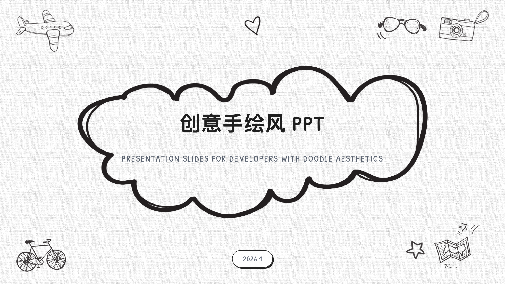
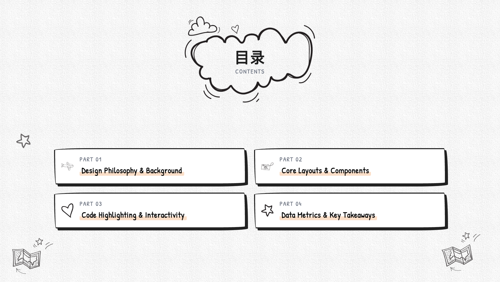
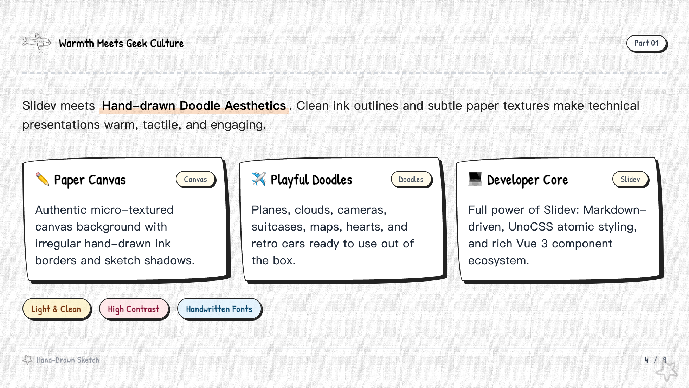
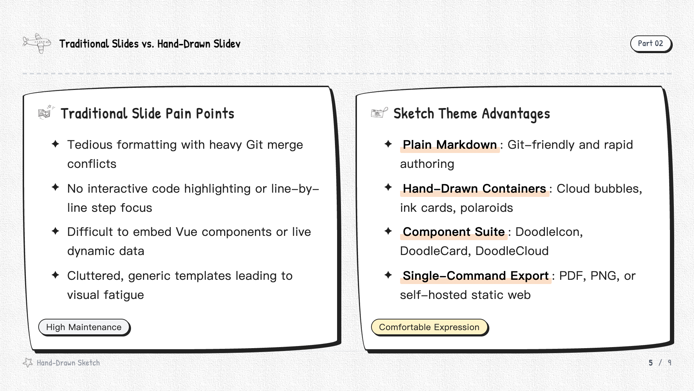
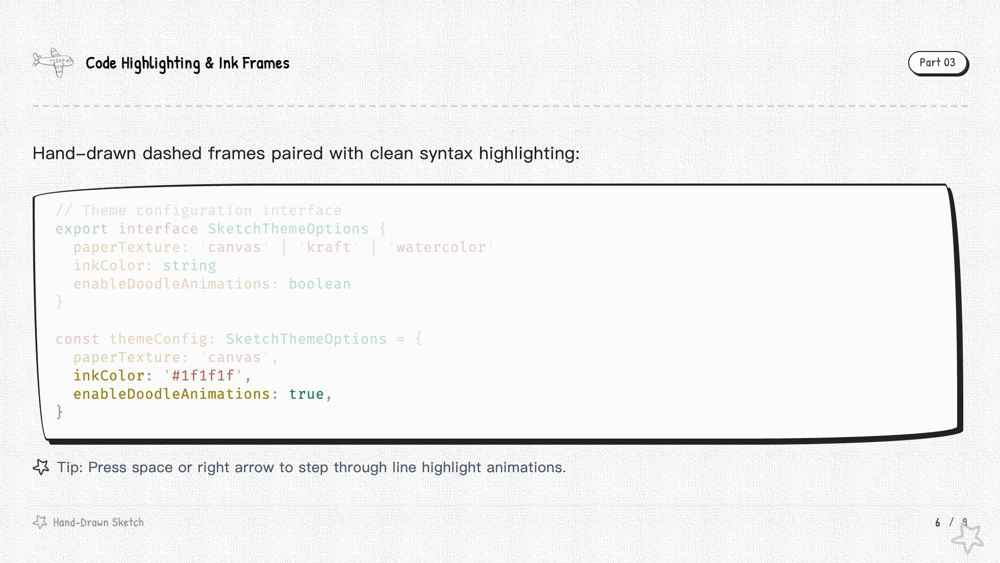
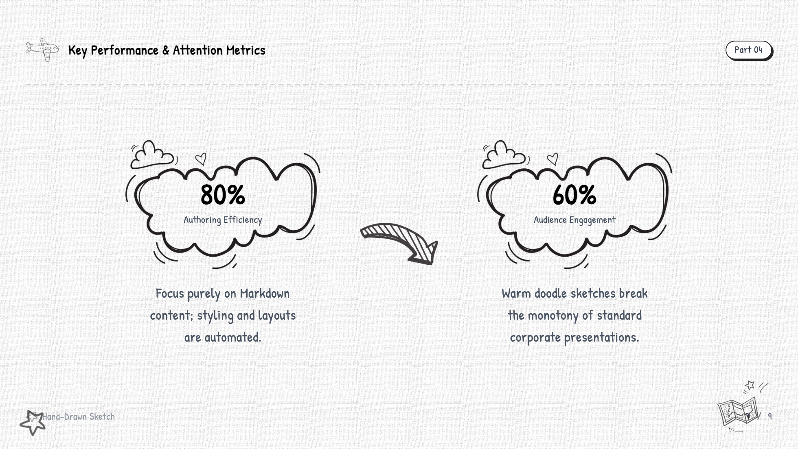

# slidev-theme-sketch 🎨

[](https://www.npmjs.com/package/slidev-theme-sketch)
[](https://opensource.org/licenses/MIT)
[](https://github.com/slidevjs/slidev)

A creative hand-drawn doodle and sketch theme for [Slidev](https://sli.dev/). Features authentic paper textures, hand-sketched ink frames, playful doodles, and tactile presentation components.

---

## Previews

<p align="center">
  
  
</p>

<p align="center">
  
  
</p>

<p align="center">
  
  
</p>

---

## Features

- 📜 **Canvas Paper Texture**: Built-in subtle paper texture canvas background for tactile warmth.
- ☁️ **Doodle Cloud Frames**: Hand-drawn double-line cloud frames for titles and section dividers.
- ✈️ **Hand-Drawn Illustration Assets**: Vector/PNG doodles ready out of the box (paper airplanes, polaroid cameras, sunglasses, suitcases, foldable maps, beetle cars, doodle stars, and ink arrows).
- 📦 **Rich Layout Set**: Ready-to-use layouts tailored for storytelling, comparisons, code walkthroughs, and key metrics.
- 🧩 **Interactive Hand-Drawn Components**: High-contrast ink cards, cloud containers, customizable doodle tags, and doodle icons.
- 🖋️ **Handwriting Font Stacks**: Pre-configured hand-drawn font pairing with `Caveat`, `Patrick Hand`, and `LXGW WenKai`.

---

## Getting Started

### Installation

Install the theme package in your Slidev project:

```bash
npm i slidev-theme-sketch
# or
pnpm add slidev-theme-sketch
# or
yarn add slidev-theme-sketch
```

### Usage

Add `theme: sketch` to the frontmatter of your `slides.md`:

```yaml
---
theme: sketch
title: My Creative Presentation
---
```

---

## Built-in Layouts

| Layout | Description |
| :--- | :--- |
| `cover` | Hero cover with hand-drawn cloud frame, title, subtitle, author, and flying doodles |
| `toc` | Agenda / table of contents with structured doodle cards |
| `section` | Chapter transition divider with animated airplane and cloud |
| `default` | Standard content layout with header plane, custom title, and progress footer |
| `two-cols` | Two-column layout with side-by-side sketch comparison cards |
| `fact` | Key performance indicators and data highlights with doodle clouds and ink arrows |
| `quote` | Inspiring quotation layout with sketch sticky note and large quotation marks |
| `end` | Closing slide for Q&A, thank you, and social links |

---

## Components

### `<DoodleCard>`

A hand-drawn container with irregular ink outlines and sketch drop-shadows:

```html
<DoodleCard title="✏️ Paper Canvas" tag="Design">
  Micro-textured paper canvas with irregular ink strokes.
</DoodleCard>
```

### `<DoodleCloud>`

A hand-drawn cloud container that wraps arbitrary text, numbers, or metrics:

```html
<DoodleCloud width="240px">
  <span class="text-4xl font-bold font-hand text-black">80%</span>
  <span class="text-xs font-hand text-gray-600">Efficiency</span>
</DoodleCloud>
```

### `<DoodleIcon>`

Embed hand-drawn doodle icons directly into headings or lists:

```html
<DoodleIcon name="plane" size="sm" />
<DoodleIcon name="camera" size="sm" />
<DoodleIcon name="heart" size="sm" />
<DoodleIcon name="star" size="xs" />
<DoodleIcon name="suitcase" size="sm" />
<DoodleIcon name="car" size="sm" />
<DoodleIcon name="map" size="sm" />
```

### `<DoodleTag>`

Pill tags with hand-drawn border styling:

```html
<DoodleTag color="yellow">Light & Clean</DoodleTag>
<DoodleTag color="red">High Contrast</DoodleTag>
<DoodleTag color="blue">Handwritten</DoodleTag>
```

---

## Development

To preview and develop the theme locally:

```bash
git clone https://github.com/yuluo-yx/slidev-theme-sketch.git
cd slidev-theme-sketch

pnpm install
pnpm dev
```

To export the example slides as high-resolution screenshots:

```bash
pnpm export example.md --format png --output screenshots
```

---

## License

[MIT](./LICENSE) © [Yuluo](https://github.com/yuluo-yx)
